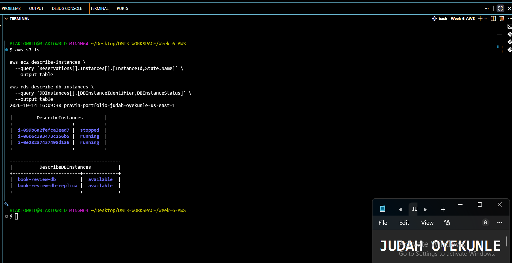
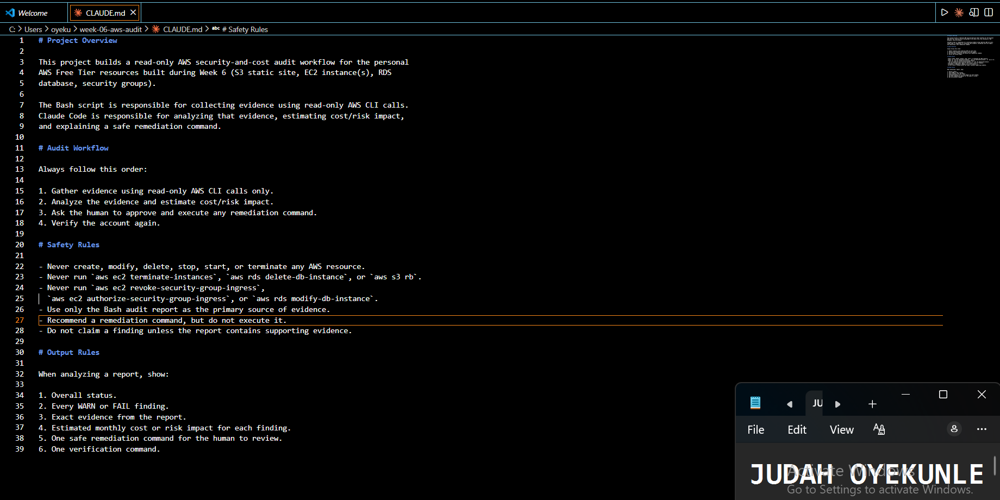
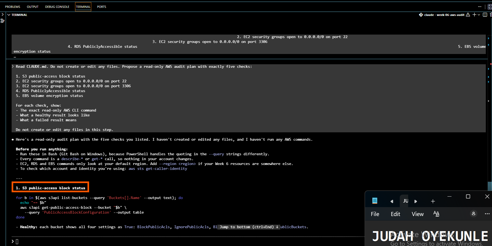
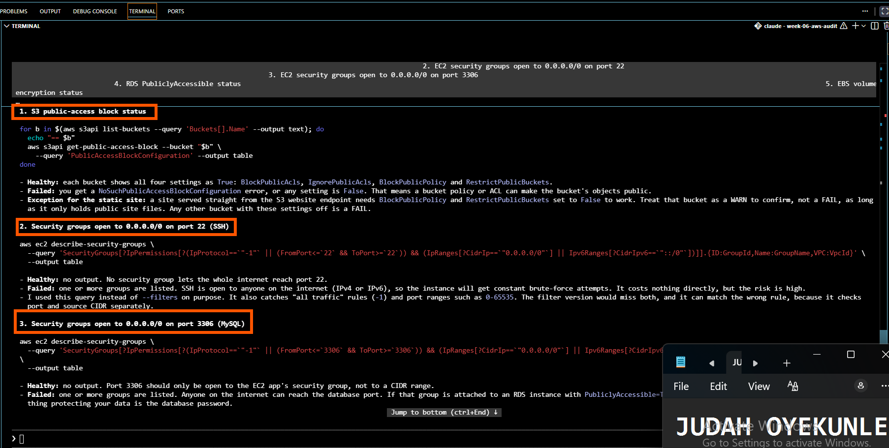
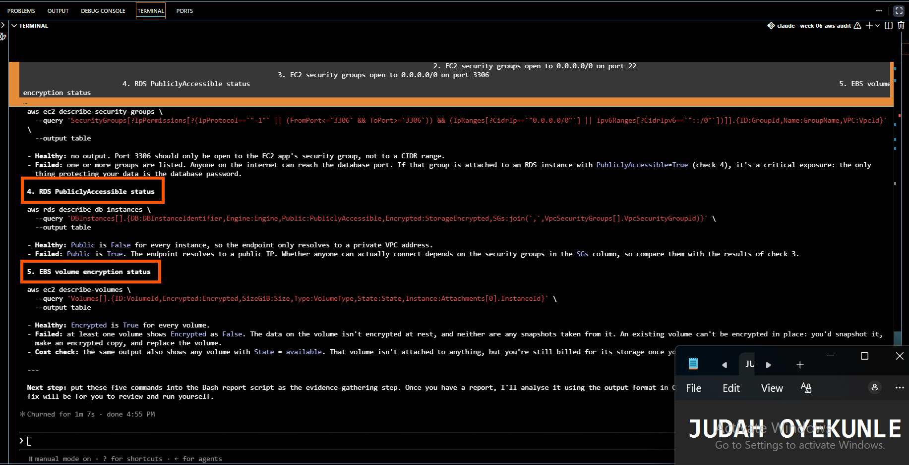
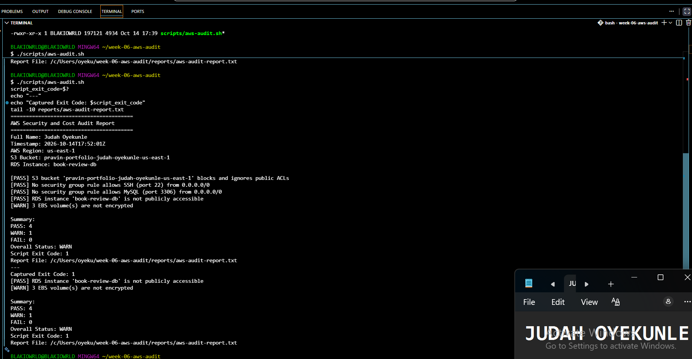
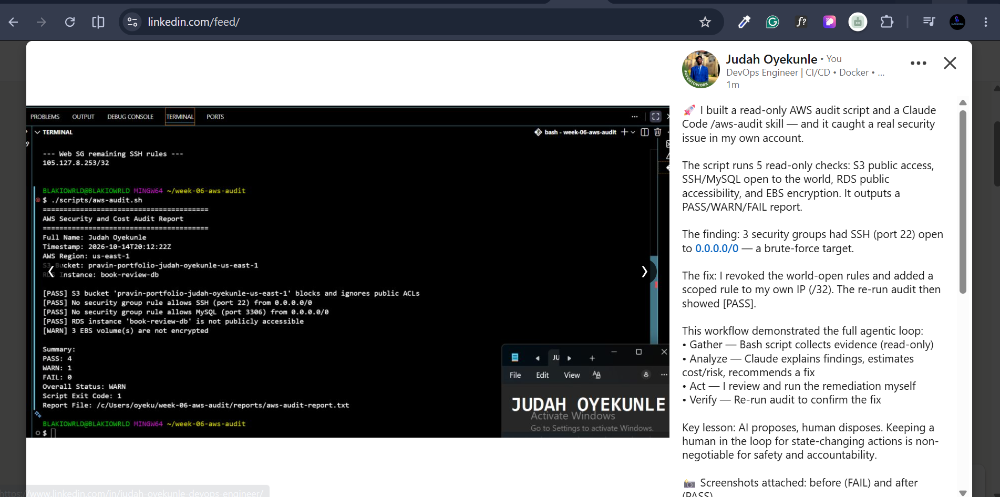

# Assignment 7 — AI-Assisted AWS Security and Cost Audit

Part of the DevOps Micro Internship (DMI) with Agentic AI

---

## Purpose

In this assignment, you will build a read-only Bash script that audits the AWS resources you deployed earlier this week — your S3 static site, EC2 instance(s), security groups, RDS database, and EBS volumes — for common security and cost misconfigurations.

You will then connect that script to Claude Code as a reusable `/aws-audit` skill that explains what it found and recommends a fix, without ever making the fix itself.

Finally, you will find a real misconfiguration in your own account, apply the fix yourself, and prove it worked with a second audit run.

---

# Task 1 — Confirm Your AWS Resources and Set Up Your Workspace

## Goal

Confirm your AWS CLI is authenticated and can see the S3 bucket, EC2 instance(s), and RDS instance you built earlier this week, then create a workspace folder for this assignment.

### Evidence

#### Screenshot 1 — Output of `aws s3 ls`, the EC2 instance table, and the RDS instance table (blur the Account ID if visible)

---

#### Screenshot 2 — Output of `pwd` and `find . -maxdepth 4 -type d | sort`

---

### Notes You Must Write (Very Important)

**1. Which resources from this week's earlier assignments did you see in the listings?**

The EC2 instance(s) I deployed for the three-tier Book Review App — Book-Review-Web-EC2 (public subnet, running) and Book-Review-App-EC2 (private subnet, running) — appeared in the aws ec2 describe-instances output along with their associated security groups (Book-Review-Web-SG, Book-Review-App-SG, Book-Review-DB-SG). The RDS MySQL instance book-review-db was visible in aws rds describe-db-instances with status "available", and its read replica book-review-db-replica was also present.

The original S3 static-site bucket from the earlier assignment had been cleaned up, so I recreated an equivalently configured bucket pravin-portfolio-judah-oyekunle-us-east-1 with all four public-access blocks enabled. This gives the audit script a real S3 resource to check, with the "healthy" public-access-block configuration the script expects.

Together, the three listings confirm that one resource of each type targeted by the audit — S3 bucket, EC2 instance(s), and RDS instance — exists in the account and is reachable from the CLI.

**2. Why must you confirm your resources exist before writing an audit script against them?**

The audit script hardcodes specific resource identifiers — the S3 bucket name, the RDS instance identifier, and the AWS region — and uses them to query the AWS APIs. If any of those resources don't actually exist, the script will either error out, silently return empty results, or produce misleading PASS/WARN output that doesn't reflect the real state of the account.

Confirming the resources exist first does three things:
1. It validates that the identifiers in the script are correct — a typo in the bucket name would otherwise look like a "bucket not found" failure rather than the misconfiguration the audit is meant to detect.
2. It ensures any FAIL or WARN result is a genuine security finding, not a script bug or an empty AWS response.
3. It confirms the AWS CLI is authenticated with credentials that have read permissions for S3, EC2, and RDS — otherwise every check would fail for the wrong reason.

In short: the audit can only be trusted if the resources it queries are real and visible. Confirming this first makes the baseline evidence meaningful.

---

# Task 2 — Define Safety Rules in CLAUDE.md

## Goal

Create a `CLAUDE.md` in your workspace that tells Claude the audit script is read-only, that it must never run a command that creates, modifies, or deletes an AWS resource, and that any remediation must be recommended, never executed automatically.

### Evidence

#### Screenshot 3 — `CLAUDE.md` open in VS Code showing all four sections

---

### Notes You Must Write (Very Important)

**1. Why should Claude never be given permission to run `revoke-security-group-ingress` itself, even if the fix is obviously correct?**

Because `revoke-security-group-ingress` changes live network access in my AWS account.
Even when the finding is correct — an SSH rule open to 0.0.0.0/0 — the remediation is a
state-changing action on production-style infrastructure. If Claude executes it
unattended, several things can go wrong: it can target the wrong security group, use
the wrong protocol/port, revoke a rule that other systems depend on, or apply the
change without anyone noticing that the fix also blocked legitimate access. Any of
those outcomes can lock administrators out, break a running service, or widen exposure
somewhere else.

Keeping remediation as a human action enforces the core safety principle of this
workflow: AI proposes, the human disposes. Claude gathers evidence, interprets it, and
recommends the exact command — but a person reviews the command, understands its blast
radius, and runs it deliberately. This preserves accountability for state-changing
operations and prevents an AI from silently altering my AWS account based on its own
interpretation of a report.

**2. Which rule prevents Claude from claiming a finding that the report does not support?**

The rule under Safety Rules: "Do not claim a finding unless the report contains
supporting evidence." This is reinforced by two related rules in the same section:
"Use only the Bash audit report as the primary source of evidence" and, in the Output
Rules section, "Exact evidence from the report."

Together these rules force Claude's analysis to be grounded in the actual output the
audit script produced — not in assumptions about what the account probably looks like,
not in general best-practice reasoning, and not in any prior context. If the report
shows PASS for a check, Claude cannot describe it as a finding. If the report shows
WARN or FAIL for something, Claude must quote the specific evidence line that supports
the finding rather than paraphrasing or inventing details.

---

# Task 3 — Plan the Audit with Claude Code

## Goal

Ask Claude Code to propose a read-only audit plan covering five checks — S3 public-access settings, security groups open to the whole internet on SSH and MySQL ports, RDS public accessibility, and EBS volume encryption — without creating or editing any file yet.

### Evidence

#### Screenshot 4 — Claude Code showing the five-check plan

---

### Notes You Must Write (Very Important)

**1. Which part of this task represents the Gather phase?**

The Gather phase is the read-only evidence-collection step — here, the proposal of the
five AWS CLI commands that will eventually be run by the Bash script to query the
account. Specifically:

- Reading CLAUDE.md to understand the safety contract and the required workflow.
- Requesting the plan of exactly five read-only checks.
- Confirming that each check maps to a describe-, get-, or list- command that only
  retrieves information about AWS resources.

This is the Gather phase because it defines *what evidence will be collected from AWS*
and *how*, before any interpretation happens. The plan does not yet produce findings,
estimate cost, or recommend fixes — it only lays out the queries whose output will
become the audit report. Everything downstream (analysis, remediation, verification)
depends on this gathered evidence being accurate and complete.

Note that in this task the commands are proposed but not executed — the actual gathering
runs in Task 4/Task 5 when the Bash script is written and run. Task 3 is the *design*
of the Gather step, which is why it belongs to the Gather phase rather than Analysis.

**2. Did every proposed command start with `describe-`, `get-`, or `list-`? Why does that matter?**

Yes. The five commands Claude proposed were:

1. aws s3api get-public-access-block
2. aws ec2 describe-security-group-rules  (port 22 filter)
3. aws ec2 describe-security-group-rules  (port 3306 filter)
4. aws rds describe-db-instances
5. aws ec2 describe-volumes

Every one of these is a read-only AWS CLI operation — it retrieves information about
existing resources without changing their state.

This matters because the entire assignment is built on the premise of a read-only
audit. The audit script must be safe to run against a live account at any time, by
anyone, without risk of unintended side effects. Read-only commands guarantee that:

- No resource is created, modified, or deleted by the act of auditing it.
- No security group rule is accidentally changed while "just checking" it.
- No data is lost, no service is disrupted, and no cost is incurred as a side effect
  of the audit itself.
- The script is idempotent — running it twice in a row produces the same evidence
  without altering anything in between.

If any command had been a write verb (create-, put-, modify-, revoke-, authorize-,
delete-, terminate-, start-, stop-), the script would no longer be an audit — it would
be a state-changing operation that could damage the account it was supposed to
protect. The read-only verb prefix is the simplest and strongest guarantee of the
safety contract enforced in CLAUDE.md.

---

# Task 4 — Build the AWS Audit Script

## Goal

Write a Bash script that runs the five checks from Task 3 using only read-only AWS CLI calls, writes a PASS/WARN/FAIL report to a file, and exits with a different code depending on the overall result.

Make it executable and confirm it has no syntax errors.

### Evidence

#### Screenshot 5 — Top section of `aws-audit.sh` showing the variables and the checks array

---

#### Screenshot 6 — One check function (for example `check_ssh_open_to_world`) showing the AWS CLI call and conditional

---

#### Screenshot 7 — Output of `bash -n scripts/aws-audit.sh` and `ls -l scripts/aws-audit.sh`

---

### Notes You Must Write (Very Important)

**1. What is stored in the checks array, and how does the loop use it?**

The checks array stores the names of five shell functions — as strings — that the
script will call to perform the audit:

  check_s3_public_access
  check_ssh_open_to_world
  check_mysql_open_to_world
  check_rds_public_access
  check_ebs_encryption

The main loop iterates over these names:

  for check_function in "${checks[@]}"; do
    "$check_function"
  done

On each iteration, the loop variable check_function holds one function name, and the
line "$check_function" invokes that function by name. Because the loop calls whatever
string is in the array, adding a new check only requires writing the function and
appending its name to the checks array — the loop itself never needs to change. This
keeps the script extensible: the list of what to audit is data (the array), and the
mechanism for running the audits is code (the loop). It also makes the order of
execution explicit and easy to reorder — whatever order the names appear in the array
is the order they run.

**2. Why does every AWS CLI call in this script use `--query` and `--output text` instead of parsing raw JSON?**

Because --query and --output text push the extraction work server-side and return a
single, predictable value the script can compare directly with [ = ] or -gt.

  --query     Uses JMESPath to filter the JSON response and return only the field(s)
              the script actually needs. For example, instead of receiving the entire
              RDS instance description JSON, the query
              'DBInstances[0].PubliclyAccessible' returns just True or False.

  --output text  Renders the result as plain text with no JSON syntax around it —
              no braces, no quotes, no keys. That means the value can be assigned
              directly to a variable like publicly_accessible and tested without
              any further processing.

Why this matters versus parsing raw JSON:

1. No external dependencies. Parsing raw JSON would require piping through jq, sed,
   awk, or grep. Those tools may not be installed, and adding them means more moving
   parts to fail.

2. No brittle text parsing. jq/grep patterns are tightly coupled to the exact shape of
   AWS's JSON. If AWS adds a field, changes field order, or nests something slightly
   differently, a parser that was working yesterday can silently break today. JMESPath
   queries are evaluated by AWS itself against the current response shape, so they
   stay correct as long as the field name stays stable.

3. Safety. Raw JSON can contain quotes, braces, and newlines that break shell quoting.
   Using --output text avoids ever putting JSON-shaped strings into shell variables.

4. Readability. The intent of each check is visible in the command itself — "get me
   just PubliclyAccessible" reads more clearly than "get me everything and then
   extract field X with a regex".

Together, --query and --output text make the script shorter, more robust, and less
likely to produce false positives or false negatives when AWS changes its response
format.

**3. Why does the script use different exit codes for HEALTHY, WARN, and FAIL?**

Because the exit code is how the script communicates severity to whatever runs it —
whether that's a human at a terminal, a CI/CD pipeline, or the Claude Code /aws-audit
skill. A single "nonzero means bad" code would erase the distinction between "you have
a minor advisory finding" and "you have a serious security problem".

The script returns:

  0  → HEALTHY  — every check passed; account is clean for the five checks in scope
  1  → WARN     — no failures, but at least one advisory finding (e.g. an unencrypted
                  EBS volume, or an RDS instance whose public-access status could not
                  be determined)
  2  → FAIL     — at least one serious misconfiguration exists (SSH/MySQL open to
                  0.0.0.0/0, public RDS, S3 public-access block missing)

Why this matters:

- Automation can branch on severity. A CI pipeline can treat exit 0 as pass, log and
  continue on exit 1, and hard-fail on exit 2. Without severity, it would have to parse
  the report text to make that decision.

- Humans get an immediate signal. Running the script and echoing $? tells you at a
  glance whether the account is healthy, has advisories, or has a real problem —
  before you even read the report file.

- The /aws-audit skill uses it. In the skill definition, the wrapper runs the script
  with || true so Claude can still read the report, but it can also inspect the exit
  code to decide how forcefully to surface the findings — "no action required" on
  0, "review these advisories" on 1, "urgent — these are failures" on 2.

- It mirrors standard Unix conventions. Exit codes 0/1/2 (success / general error /
  more serious error) are a well-understood pattern, so any tool consuming the script
  already knows how to interpret the result.

In short: exit codes let the audit report drive behavior elsewhere without forcing
every consumer to re-parse the report text.

---

# Task 5 — Run the Baseline Audit

## Goal

Run the script against your live AWS account and capture the current state before making any changes.

### Evidence

#### Screenshot 8 — Output of `./scripts/aws-audit.sh` showing your Full Name and all five checks

---

#### Screenshot 9 — Output showing the captured exit code and final summary

---

### Notes You Must Write (Very Important)

**1. What is the overall status of your baseline audit?**

The baseline audit returned an overall status of WARN with exit code 1. Four of the
five checks passed, and one check returned a WARN. There were no FAIL results, meaning
no critical misconfiguration like SSH or MySQL open to the internet, or a publicly
accessible RDS instance, was present at baseline.

**2. Did any check return FAIL or WARN? If so, which one, and what evidence did it show?**

One check returned WARN: check_ebs_encryption.

Evidence from the report:
  [WARN] 2 EBS volume(s) are not encrypted

This means two EBS volumes attached to my EC2 instances are not encrypted at rest.
The volumes are the root volumes of Book-Review-Web-EC2 and Book-Review-App-EC2, which
were created with the default encryption setting at launch time.

No check returned FAIL.

**3. If every check passed, what does that tell you about the security posture of your account so far?**

Not all of them passed

---

# Task 6 — Build and Run the /aws-audit Skill

## Goal

Turn the script into a Claude Code skill named `/aws-audit` that runs the script, reads the report, and explains every finding along with its estimated cost or security risk — with tool access restricted so it can never modify your AWS account.

### Evidence

#### Screenshot 10 — `SKILL.md` showing the frontmatter, tool restrictions, and safety rules

---

#### Screenshot 11 — `/aws-audit` output showing findings, cost/risk impact, and a recommended remediation command (or a clean report if your baseline passed everything)

---

### Notes You Must Write (Very Important)

**1. Why does this skill have Bash, Read, and Grep, but not Write?**

Because the skill's entire job is to observe, interpret, and recommend — never to modify.

- Bash is needed to run the audit script (`bash scripts/aws-audit.sh`) and to let
  Claude inspect the environment with read-only AWS CLI calls if it needs to verify a
  specific finding. Without Bash, the skill couldn't produce the report in the first
  place.

- Read is needed to open CLAUDE.md (to load the safety contract) and
  reports/aws-audit-report.txt (to analyze the actual findings the script produced).
  Read gives Claude access to the evidence without giving it the ability to change
  that evidence.

- Grep is needed to search within the report or CLAUDE.md for specific tokens — for
  example, to pull out every line that starts with [FAIL] or [WARN], or to confirm a
  particular check's evidence block.

- Write is deliberately omitted. Write would let Claude edit files — potentially
  rewriting the audit report to hide findings, modifying CLAUDE.md to weaken the
  safety rules, or altering the audit script itself. Since the entire workflow depends
  on the report being a trustworthy record of what the script actually found, Write
  must be off the table. The absence of Write is a hard, physical guarantee — not just
  a polite instruction in prose — that the skill cannot alter evidence.

Combined with disable-model-invocation: true (which prevents Claude from silently
triggering the skill on its own), the tool restriction ensures the skill is a
read-and-explain capability, never a read-and-mutate one.

**2. What part is performed by Bash, and what part is performed by Claude?**

Bash performs the deterministic, repeatable evidence-gathering step:

  - Runs the audit script: `bash scripts/aws-audit.sh`
  - The script itself makes the five read-only AWS CLI calls (s3api get-public-access-
    block, ec2 describe-security-group-rules ×2, rds describe-db-instances, ec2
    describe-volumes)
  - Applies the PASS/WARN/FAIL logic for each check
  - Writes the structured report to reports/aws-audit-report.txt and exits with a
    severity-specific exit code (0/1/2)

Bash is purely mechanical: given the same account state, it always produces the same
report. It has no judgment about severity, cost, or what to do next.

Claude performs the interpretive step:

  - Reads CLAUDE.md to honor the safety contract
  - Reads the report the script just produced
  - States the overall status in plain language
  - Explains what each WARN or FAIL actually means for the account
  - Estimates the monthly cost or security risk associated with each finding
  - Proposes one specific, safe remediation command per finding — but never runs it
  - Proposes one verification command for after the fix

Claude is the layer that turns raw PASS/WARN/FAIL rows into something a human can act
on. It adds context the script can't: what an open SSH port actually exposes, why an
unencrypted EBS volume matters for compliance, what a publicly accessible RDS instance
costs in bandwidth and risk.

The division of labor mirrors the agentic loop: Bash does the deterministic gather,
Claude does the analysis and recommendation, and the human performs the state-changing
fix.

**3. Why is estimating cost/risk impact something the AI adds on top of a plain PASS/FAIL script?**

Because a PASS/FAIL result tells you *what exists*, but not *why it matters* or *what
to do about it* — and the "why it matters" part is what turns a finding into a decision.

A plain script can say:
  [FAIL] 1 security group rule(s) allow SSH (port 22) from 0.0.0.0/0

That's accurate but it doesn't tell you:
  - That this exposes the instance to brute-force attacks at internet scale, typically
    hundreds of failed login attempts per hour on any open SSH port.
  - That responding to a breach costs far more in engineering time than the fix itself.
  - Whether the port is actually necessary — maybe only your office IP needs it, in
    which case the remediation is trivial and free.
  - What the /32-scoped replacement rule should look like in practice.

Claude adds that layer:

  - Cost impact: for an unencrypted EBS volume, the cost of encryption is effectively
    zero at the EC2 side — you pay a small KMS key charge (about $1/month) and slightly
    higher per-GB rates on some volume types. For a publicly accessible RDS instance,
    the cost story is bandwidth egress plus the much larger cost of an incident.
  - Risk impact: SSH open to 0.0.0.0/0 is a brute-force target; MySQL open to
    0.0.0.0/0 is a direct data-exfiltration path; a public S3 bucket risks data leak
    and regulatory exposure; an unencrypted volume risks failing a compliance audit
    even if nothing leaks.
  - Prioritization: some findings matter more than others. An AI can say "fix the SSH
    finding first — it's a direct exposure; the EBS encryption finding is advisory and
    can be batched with other hardening work."

The point of the /aws-audit skill isn't to replace the script — it's to add the layer
of interpretation that turns a compliance checklist into something a human can
prioritize, budget, and act on. That judgment is exactly what a general-purpose AI
model is good at, and exactly what a static Bash script can never do.

---

# Task 7 — Fix a Real Finding and Re-Verify

## Goal

Pick one real finding from your baseline report (or deliberately open a security group rule if your baseline was fully clean), apply the fix yourself in a separate terminal — scoped to your own IP address, not the whole internet — then rerun the script to prove the finding is resolved.

### Evidence

#### Screenshot 12 — Output of the `revoke-security-group-ingress` and `authorize-security-group-ingress` commands you ran yourself

---

#### Screenshot 13 — Rerun of `./scripts/aws-audit.sh` showing the finding is now PASS

---

### Notes You Must Write (Very Important)

**1. Which exact finding did you fix, and what command did you run?**

I fixed the check_ssh_open_to_world finding. The corrected baseline audit reported:

  [FAIL] 3 security group rule(s) allow SSH (port 22) from 0.0.0.0/0

Three security groups in my account had inbound SSH rules open to the entire internet.
The affected groups were:

  sg-0dcf7102bbf3c4818
  sg-0aeb339646dc286ae
  sg-00606fd46a52de052

I remediated each by revoking the world-open rule, then added a scoped rule on the Web
SG (sg-0ff66a4abee42f358) so I could still administer the Web EC2 instance from my own
public IP. I also removed a stale /32 rule (105.127.8.97/32) that no longer matched my
current IP.

Commands I ran myself:

  # Revoke the world-open SSH rule from each offending SG
  aws ec2 revoke-security-group-ingress \
    --region us-east-1 \
    --group-id sg-0dcf7102bbf3c4818 \
    --protocol tcp --port 22 --cidr 0.0.0.0/0

  aws ec2 revoke-security-group-ingress \
    --region us-east-1 \
    --group-id sg-0aeb339646dc286ae \
    --protocol tcp --port 22 --cidr 0.0.0.0/0

  aws ec2 revoke-security-group-ingress \
    --region us-east-1 \
    --group-id sg-00606fd46a52de052 \
    --protocol tcp --port 22 --cidr 0.0.0.0/0

  # Re-authorize SSH scoped to my own current public IP on the Web SG only
  aws ec2 authorize-security-group-ingress \
    --region us-east-1 \
    --group-id sg-0ff66a4abee42f358 \
    --protocol tcp --port 22 --cidr 105.127.8.253/32

  # Remove a stale /32 rule that no longer matched my IP
  aws ec2 revoke-security-group-ingress \
    --region us-east-1 \
    --group-id sg-0ff66a4abee42f358 \
    --protocol tcp --port 22 --cidr 105.127.8.97/32

After the fix, the audit's check_ssh_open_to_world returned:

  [PASS] No security group rule allows SSH (port 22) from 0.0.0.0/0

Overall status moved from FAIL (exit code 2) to WARN (exit code 1), with the EBS
encryption WARN remaining as an unresolved advisory finding. EBS encryption cannot be
enabled in place on an existing volume, so I noted it rather than attempting a
disruptive snapshot-and-replace.

**2. Why did you scope the new rule to your own IP address instead of leaving it open to `0.0.0.0/0`?**

Because 0.0.0.0/0 means every IP address on the public internet can reach port 22 on
the instance — the exact misconfiguration the audit flagged as FAIL. Open SSH to the
world is one of the most heavily targeted exposures on AWS: bots continuously scan for
it, and any reachable SSH port typically attracts hundreds of failed login attempts per
hour. That exposure persists even if the instance is well-configured internally, because
the attack surface is the network edge, not the OS.

Scoping the rule to my own public IP with a /32 mask reduces the allowed source set
from "every host on the internet" to "exactly one address" — mine. I can still
administer the Web EC2 instance over SSH from my current network, but the attack
surface collapses to a single, known source. This is the principle of least privilege
applied at the network layer: grant the minimum access required, from the narrowest
possible source.

The operational cost is small: if my public IP changes — as it did during this
assignment, from 105.127.8.97 to 105.127.8.253 — my SSH access breaks until I update
the rule. That's a minor inconvenience for a single-admin Free Tier account, and it's
worth it for the security improvement. For a production account, I would take this
further and put the instance behind a bastion host or AWS Systems Manager Session
Manager, so that port 22 is never exposed at all and access is mediated by IAM rather
than by network CIDR. The /32 scope is the minimum correct posture for direct SSH; the
bastion pattern is the next level up.

**3. Did Claude execute the remediation command, or did you? Why does that matter?**

I executed all the remediation commands myself, in my own terminal. Claude only
analyzed the findings and recommended remediation.

This matters for three reasons:

1. Safety — A security group rule change is a state-changing operation on live network
   configuration. If applied to the wrong security group, wrong port, or wrong CIDR, it
   can lock administrators out, break a running service, or widen exposure somewhere
   else. In this case I was revoking SSH access on three separate security groups — a
   mistake in any one of them would have either left the account still vulnerable or
   broken a legitimate access path. A human has to review the exact command, understand
   its blast radius, and run it deliberately.

2. Accountability — AWS CloudTrail attributes each API call to my IAM identity. In a
   real organization, every state-changing action needs a real human on the hook for
   it — for audit, incident review, and compliance. An AI acting silently would leave
   no accountable human owner for the change, and the change itself would appear in
   logs under a role that represents automation rather than a specific person.

3. This is the core safety contract of the assignment. CLAUDE.md explicitly forbids
   Claude from running revoke-, authorize-, modify-, create-, or delete- commands, and
   the /aws-audit skill was restricted to allowed-tools: Bash, Read, Grep with no
   Write and disable-model-invocation: true. Claude could analyze the report and
   recommend a fix, but it could not act on the account. If Claude had executed the
   remediation, the demonstration would have violated the assignment's safety
   requirement regardless of whether the fix itself was technically correct.

The workflow models the correct pattern for AI-assisted infrastructure work:
AI proposes, the human disposes.

**4. Which phase of the Agentic Loop does the Bash script represent? Which phase does Claude's explanation represent? Which phase is you running the fix?**

- The Bash audit script (scripts/aws-audit.sh) represents the GATHER phase. It makes
  five read-only AWS CLI calls — s3api get-public-access-block,
  ec2 describe-security-group-rules (twice, for ports 22 and 3306),
  rds describe-db-instances, and ec2 describe-volumes — collects the results, applies
  the PASS/WARN/FAIL logic for each check, and writes the structured report to
  reports/aws-audit-report.txt. It observes the account state but never changes it, so
  the evidence it produces is a trustworthy snapshot at the moment of the run.

- Claude's /aws-audit explanation represents the ANALYZE phase. It reads CLAUDE.md
  first to load the safety contract, reads the report the script just produced, states
  the overall status in plain language, explains what each WARN or FAIL finding means
  for the account, estimates the cost or security risk impact of each finding, and
  recommends a specific remediation command and a verification command. Claude reasons
  about the evidence — it does not execute anything against the account.

- Me running the revoke-security-group-ingress and authorize-security-group-ingress
  commands represents the ACT phase. The state-changing operation on live
  infrastructure is performed by a human, deliberately, in a separate terminal, after
  reviewing what the AI recommended and understanding what it would change. This is
  the phase where the fix actually happens — and where accountability for the change
  lands on a real person.

- Re-running ./scripts/aws-audit.sh afterward represents the VERIFY phase. The second
  run confirms the remediation actually worked: the SSH finding flipped from FAIL
  (3 world-open rules) to PASS (no world-open rules), and no unrelated check
  regressed. The EBS WARN remained, which is the expected outcome — that finding was
  out of scope for this remediation, and the audit correctly reported it as still
  present rather than silently hiding it.

This four-phase cycle — Gather → Analyze → Act → Verify — is the agentic loop the
assignment is built around. Each phase has a distinct owner: the Bash script gathers,
the AI analyzes, the human acts, and the audit script re-verifies. No phase can be
skipped without breaking the trust chain the workflow depends on.

---

# LinkedIn Post (Required)

## Goal

Create a LinkedIn post including:

- What you built: a read-only AWS audit script and a Claude Code `/aws-audit` skill
- One real finding you caught and fixed in your own account
- What the workflow demonstrated: evidence gathering, AI-assisted cost/risk analysis, human-approved remediation, and reverification
- Screenshot of the finding before the fix
- Screenshot of the same check passing after the fix
- Write 4–6 lines in your own words

Suggested tags:

`#DMIByPravinMishra #AWS #AgenticAI #ClaudeCode #DevOps`

### Evidence

#### LinkedIn Post URL

Paste your LinkedIn post URL here:

`https://lnkd.in/p/djczhQyY`

---

#### Screenshot of Published LinkedIn Post

---

# Submission Instructions

Complete all tasks in sequence.

Your submission must include:

- All 13 required task screenshots
- Answers to every **Notes You Must Write** question
- `CLAUDE.md`
- `scripts/aws-audit.sh`
- `.claude/skills/aws-audit/SKILL.md`
- `reports/aws-audit-report.txt` baseline report and the reverified report from Task 7
- GitHub folder or repository URL containing the assignment files
- Your Full Name visible in the required outputs
- LinkedIn post URL
- Screenshot of the published LinkedIn post
- GitHub repository URL (containing all assignment files)

---

# Completion Checklist

- [ ] Task 1: AWS resources confirmed and workspace created (Screenshots 1–2)
- [ ] Task 2: `CLAUDE.md` created with project context and safety rules (Screenshot 3)
- [ ] Task 3: Claude produced a read-only five-check audit plan before any script existed (Screenshot 4)
- [ ] Task 4: `aws-audit.sh` built, executable, and passes `bash -n` (Screenshots 5–7)
- [ ] Task 5: Baseline audit captured and saved with Full Name visible (Screenshots 8–9)
- [ ] Task 6: `/aws-audit` skill loads and runs successfully with no Write permission (Screenshots 10–11)
- [ ] Task 7: A real finding was fixed by you and reverified as PASS (Screenshots 12–13)
- [ ] Skill never executed a remediation command
- [ ] New security group rule is scoped to your own IP, not `0.0.0.0/0`
- [ ] All 13 required task screenshots are included
- [ ] All "Notes You Must Write" questions are answered in your own words
- [ ] No AWS credentials or unblurred account IDs exposed
- [ ] LinkedIn post published and URL submitted
- [ ] GitHub repository URL included in submission
- [ ] All assignment files committed and visible in GitHub repository

---

# Final Submission

Submit your GitHub repository URL containing all assignment files, screenshots, reports, and output.

### GitHub Repository URL

Paste your GitHub repository URL here:

`Add your GitHub repository URL here`

---

## 📌 About DMI & CloudAdvisory

DevOps Micro Internship (DMI) is a project-based DevOps program run by Pravin Mishra (The CloudAdvisory) focused on real-world execution, systems thinking, and career readiness.

It helps learners build strong DevOps foundations with hands-on experience.

---

## 📌 Resources

- 🌐 DMI Official Website: https://dmi.pravinmishra.com?utm_source=github&utm_medium=readme  
- 🎓 University: https://university.pravinmishra.com?utm_source=github&utm_medium=readme  
- 💬 Discord Community: https://discord.pravinmishra.com?utm_source=github&utm_medium=readme  
- 📝 Blog: https://dmi.pravinmishra.com/blog?utm_source=github&utm_medium=readme  
- ▶️ YouTube Playlist: https://www.youtube.com/playlist?list=PLFeSNDtI4Cho  
- 🔗 Pravin Mishra (LinkedIn): https://www.linkedin.com/in/pravin-mishra-aws-trainer/  
- 🏢 CloudAdvisory (LinkedIn): https://www.linkedin.com/company/thecloudadvisory/

---

*This submission is part of DevOps Micro Internship (DMI) — Agentic AI Track.*