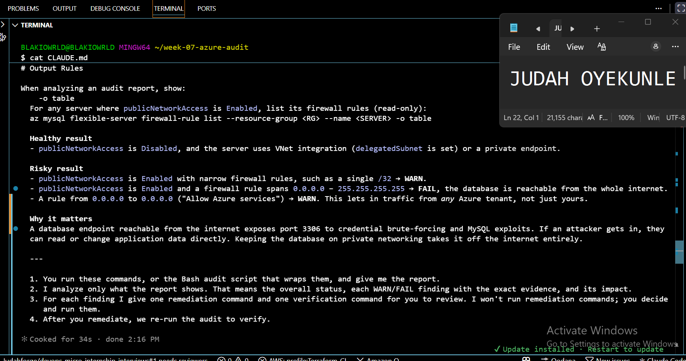
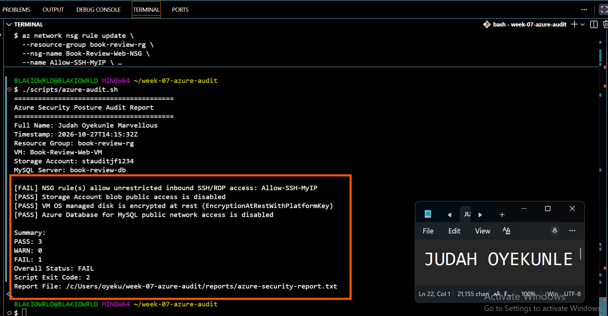
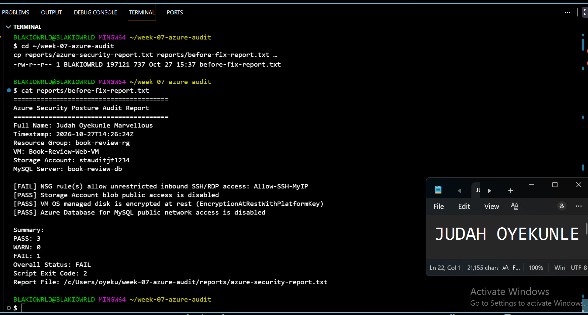
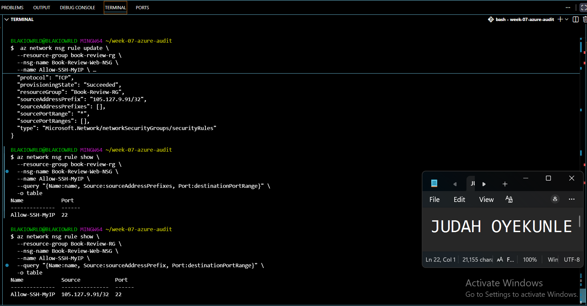

# Assignment 7 — AI-Assisted Azure Security Posture Audit

Part of the DevOps Micro Internship (DMI) with Agentic AI

---

## Purpose

In this assignment, you will build a read-only Bash script that audits the Azure resources you deployed earlier this week — a virtual machine, a three-tier network with a Load Balancer, a Storage Account, and an Azure Database for MySQL server — for common security misconfigurations. You will connect that script to Claude Code as a reusable `/azure-audit` skill that explains findings and recommends a fix without ever running it, then fix one real finding yourself and prove the fix with a second audit run. This is the same read-only-evidence-then-human-fixes discipline from Week 3, now applied to Azure with the `az` CLI instead of Linux commands — and the cloud-agnostic counterpart to the AWS audit you built in Week 6.

---

# Task 1 — Confirm Your Resources and Create the Workspace

## Goal

Confirm your Azure CLI is authenticated and can see the VM, network, storage account, and MySQL server you built this week, then set up a workspace folder for the audit.

### Evidence

#### Screenshot 1 — `az account show` and `az vm list -d -o table` confirming your subscription and running VM (subscription ID partially blurred)

---

# Task 2 — Create Project Context and Safety Rules in CLAUDE.md

## Goal

Create a `CLAUDE.md` for this workspace that tells Claude what the audit covers and the safety rules it must follow: never run a mutating `az` command, never claim a finding without report evidence, and always let the human review and run any remediation.

### Evidence

#### Screenshot 2 — `CLAUDE.md` open in your editor showing the project overview, audit workflow, and safety rules

---

# Task 3 — Use Agentic AI to Plan the Audit Before Writing the Script

## Goal

Ask Claude Code to read `CLAUDE.md` and propose a read-only, four-check audit plan (NSG rules open to `0.0.0.0/0` on port 22 or 3389, storage account public blob access, VM disk encryption status, and Azure Database for MySQL public network access) — without creating or editing any file yet.

### Evidence

#### Screenshot 3 — Claude Code showing the four-check plan, with no files created or modified

---

# Task 4 — Build the Azure Audit Bash Script

## Goal

Write a Bash script that runs the four checks from Task 3 using read-only `az` commands, writes a PASS/WARN/FAIL report with your Full Name, and exits with a different code for a healthy, warning, or failing result. Validate it with `bash -n` and make it executable.

### Evidence

#### Screenshot 4 — Your script open in your editor, showing the check functions and the `az` commands they call

---

#### Screenshot 5 — Output of `bash -n` (no syntax errors) and `ls -l` showing the script is executable

---

# Task 5 — Run the Script and Review the Baseline Report

## Goal

Run the script against your live resources and read the report honestly, even if it shows a real finding — do not fix anything yet.

### Evidence

#### Screenshot 6 — Script output showing your Full Name and all four checks with a PASS, WARN, or FAIL result

---

# Task 6 — Create and Run the /azure-audit Skill

## Goal

Create a Claude Code skill restricted to read-only tools (no `Write`) that runs your script, reads the report, and explains every finding with the risk of leaving it unresolved — without ever running a remediation command itself.

### Evidence

#### Screenshot 7 — Your skill file's frontmatter showing `allowed-tools` without `Write`

---

#### Screenshot 8 — `/azure-audit` output showing the baseline findings and Claude's explanation

---

# Task 7 — Fix a Real Finding and Re-Verify

## Goal

Pick one WARN or FAIL finding (or deliberately open an NSG rule to port 22 from `0.0.0.0/0` if your baseline was already clean), save that failing report, run the remediation command yourself — scoped to your own IP, not left open — and confirm the second audit run shows it resolved.

### Evidence

#### Screenshot 9 — Saved report showing the original finding before the fix

---

#### Screenshot 10 — Terminal output of the remediation command you ran yourself

---

#### Screenshot 11 — Second `/azure-audit` run (or report) showing the finding resolved

---

### Notes

Compare this assignment to the AWS audit you built in Week 6: which finding categories map to each other across the two clouds, and what stayed exactly the same about the workflow even though the `az`/`aws` commands are completely different?

Notes — Comparing the Azure Audit to the Week 6 AWS Audit

Finding categories map 1:1 across the two clouds. The same four classes of misconfiguration I checked in AWS came back in Azure, just under different resource names:

- Security Group ingress rule allowing 0.0.0.0/0 on port 22 (SSH) or 3389 (RDP) → NSG inbound Allow rule with sourceAddressPrefix of "*", "Internet", or "0.0.0.0/0" on port 22/3389. Same risk: a login service exposed to the entire internet, open to brute force.
- S3 bucket with Block Public Access off / public ACL or bucket policy → Storage Account with allowBlobPublicAccess set to true. Same risk: anonymous read of object data, a classic cloud data-leak vector.
- EBS volume with Encrypted: false (or no KMS key) → Managed disk with encryption.type not starting with EncryptionAtRest. Same risk: unencrypted data at rest, exposed to disk theft or snapshot copy.
- RDS instance with PubliclyAccessible: true → MySQL Flexible Server with network.publicNetworkAccess set to Enabled. Same risk: the database engine (3306) reachable from the internet, open to credential brute force and MySQL exploitation.

The remediation that produces the fix is also structurally identical: restrict the ingress source to a single IP (<my-ip>/32) in AWS, restrict the NSG sourceAddressPrefix to <my-ip>/32 in Azure.

What stayed exactly the same about the workflow — and this is the real lesson — is that the aws and az commands share almost nothing verb-for-verb (describe-* vs show/list, authorize-security-group-ingress vs az network nsg rule update), but the discipline is cloud-agnostic:

1. Read-only evidence gathering first. Both scripts touch only describe/list/show verbs. No mutating call is ever automated.
2. The Agentic Loop is the same shape. Gather → Analyze → Recommend → Human Acts → Verify. Both weeks produce the same PASS/WARN/FAIL report structure with the same three exit codes (0 healthy, 1 warn, 2 fail).
3. Claude is constrained by allowed-tools, not by trust. Both skills exclude Write and Edit from the tool list, so even a prompt-injected instruction could not make Claude modify a file or a resource. The security boundary is enforced by what tools exist, not by what the model promises.
4. The human runs the fix. In both weeks I executed the remediation myself in a regular terminal — Week 6 to rewrite a Security Group ingress, Week 7 to narrow Allow-SSH-MyIP to 105.127.9.91/32. Claude proposed the exact command; I reviewed and ran it.
5. Fail → fix → pass, evidenced three ways. Both assignments require saving before-fix and after-fix reports so the delta is provable, not asserted.
6. Rule and resource names come from evidence, not guesses. In Week 7 Claude's remediation command carried the actual rule name (Allow-SSH-MyIP) sourced from the audit report, not a generic "SSH" — the same requirement as Week 6, where the security group ID had to be pasted from describe-security-groups rather than invented.

Where the two audits genuinely diverge is in the plumbing, and Week 7 surfaced a cloud-specific trap. Azure stores an NSG rule's source in either sourceAddressPrefix (singular, for one entry) or sourceAddressPrefixes (plural, for a list) depending on how the rule was created — so the verification query I ran after the fix initially showed an empty Source column because I queried the wrong field. AWS normalizes the equivalent to a single IpRanges array, so this pitfall does not exist there. Similarly, Azure's NSG can attach at the subnet or the NIC, whereas an AWS Security Group attaches to the resource directly; and Azure managed disk encryption has three tiers (Platform, Customer, Platform+Customer) while AWS EBS only distinguishes encrypted versus not (plus optional KMS). The read-only-then-human-fixes pattern, the PASS/WARN/FAIL contract, and the exit-code discipline carried over unchanged. Only the nouns changed.

---

# Submission Instructions

Complete all tasks in sequence.

Your submission must include:
- All 11 required screenshots
- Do not expose your Azure subscription ID, tenant ID, client secrets, or connection strings

---

# Completion Checklist

- [ ] Task 1: Azure resources confirmed and workspace created (Screenshot 1)
- [ ] Task 2: `CLAUDE.md` created with project context and safety rules (Screenshot 2)
- [ ] Task 3: Claude produced a read-only four-check plan before any script existed (Screenshot 3)
- [ ] Task 4: Audit script built, syntax-checked, and executable (Screenshots 4–5)
- [ ] Task 5: Baseline audit run and reviewed honestly (Screenshot 6)
- [ ] Task 6: `/azure-audit` skill created with no `Write` permission and run successfully (Screenshots 7–8)
- [ ] Task 7: A real finding fixed by you (not Claude) and re-verified as resolved (Screenshots 9–11)
- [ ] Notes comparing this to the Week 6 AWS audit completed
- [ ] No subscription IDs, tenant IDs, or credentials exposed

---

## 📌 About DMI & CloudAdvisory

DevOps Micro Internship (DMI) is a project-based DevOps program run by Pravin Mishra (The CloudAdvisory) focused on real-world execution, systems thinking, and career readiness.

It helps learners build strong DevOps foundations with hands-on experience.

---

## 📌 Resources

- 🌐 DMI Official Website: https://dmi.pravinmishra.com?utm_source=github&utm_medium=readme  
- 🎓 University: https://university.pravinmishra.com?utm_source=github&utm_medium=readme  
- 💬 Discord Community: https://discord.pravinmishra.com?utm_source=github&utm_medium=readme  
- 📝 Blog: https://dmi.pravinmishra.com/blog?utm_source=github&utm_medium=readme  
- ▶️ YouTube Playlist: https://www.youtube.com/playlist?list=PLFeSNDtI4Cho  
- 🔗 Pravin Mishra (LinkedIn): https://www.linkedin.com/in/pravin-mishra-aws-trainer/  
- 🏢 CloudAdvisory (LinkedIn): https://www.linkedin.com/company/thecloudadvisory/

---

*This submission is part of DevOps Micro Internship (DMI) — Agentic AI Track.*
