# Assignment 8 — AI-Assisted Docker Container Hardening Audit

Part of the DevOps Micro Internship (DMI) with Agentic AI

---

## Purpose

In this assignment, you will build a read-only Bash script that audits a running Docker container for common hardening gaps — running as root, missing health checks, unpinned image tags, privileged mode, and unnecessary exposed ports — then connect that script to Claude Code as a reusable `/docker-audit` skill. You will run the audit against your production-grade EpicBook stack, fix what it finds by editing the Dockerfile yourself, rebuild the image, and re-run the audit to prove the fix worked. Claude analyzes evidence and recommends a fix; it never edits your Dockerfile or rebuilds the image itself.

---

# Target Container

**Target Container Name:** `theepicbook-backend-1`

---

# Task 1 — Prepare the Audit Workspace

## Goal

Create an audit workspace and confirm that the supplied files are available.

### Evidence

#### Screenshot 1 — Audit Workspace Files

Add a terminal screenshot showing your full name and both supplied files:

```text
docker-audit.sh
SKILL.md
```

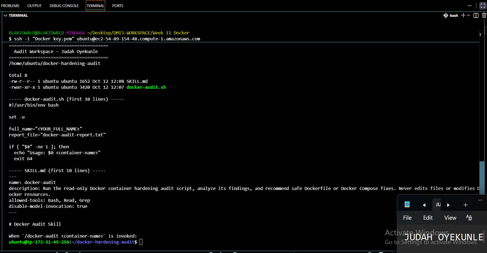

---

# Task 2 — Add the Docker Audit Skill to Claude Code

## Goal

Add the supplied `docker-audit` skill to Claude Code and confirm that it is available.

### Evidence

#### Screenshot 2 — Docker Audit Skill Available in Claude Code

Add a screenshot of Claude Code showing `docker-audit` in the available skill list.

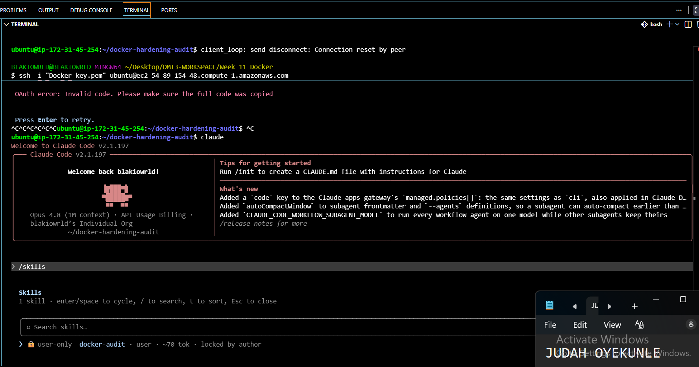

---

# Task 3 — Validate the Audit Script

## Goal

Verify the audit script line endings, Bash syntax, and usage message.

### Evidence

#### Screenshot 3 — Script Validation

Add a terminal screenshot showing:

- LF line-ending check
- Successful `bash -n docker-audit.sh` validation
- Your full name
- The usage message displayed when the script runs without a container name

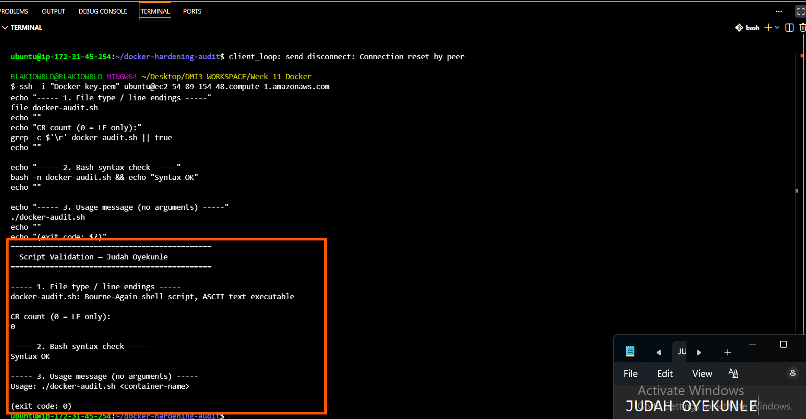

---

# Task 4 — Run the Initial Docker Security Audit

## Goal

Audit a running container and record the initial findings.

### Evidence

#### Screenshot 4 — Selected Target Container

Add a terminal screenshot showing:

- Your full name
- `docker ps`
- The audit command using the selected target container name

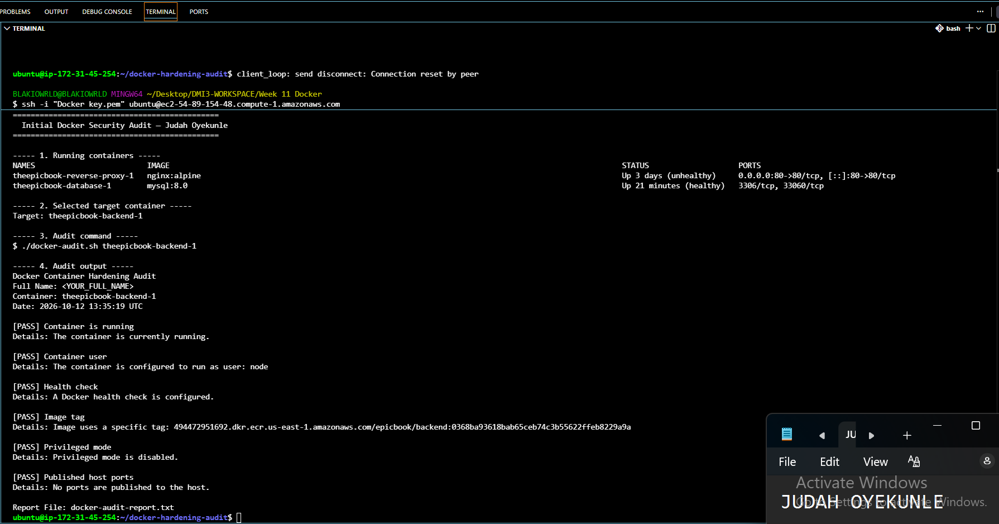

---

#### Screenshot 5 — Initial Audit Results

Add a terminal screenshot showing the initial Docker audit results.

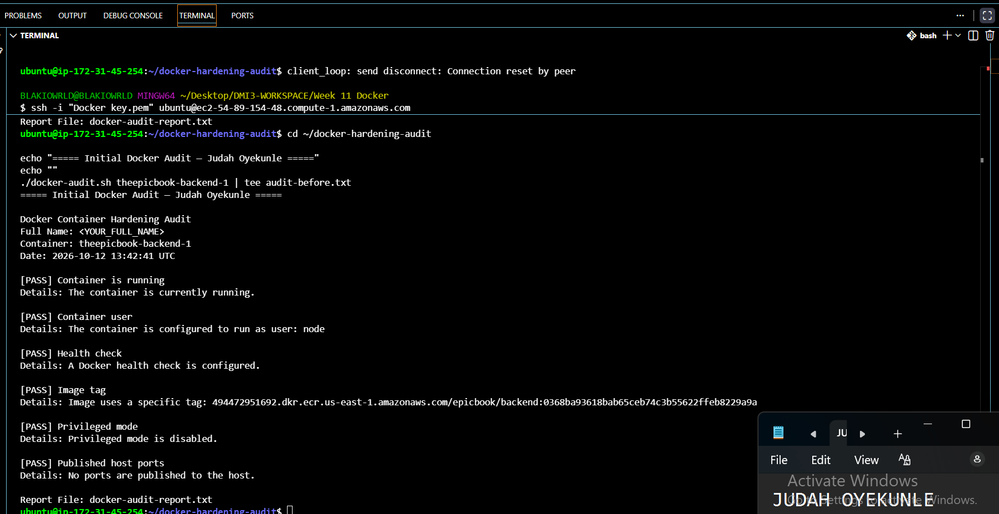

---

# Task 5 — Use AI Assistance to Understand the Findings

## Goal

Use the supplied `docker-audit` skill to understand the initial audit results safely.

### Evidence

#### Screenshot 6 — Audit Explanation and Recommended Fix

Add a Claude Code screenshot showing:

- Audit finding
- Security risk
- Recommended manual fix
- Verification method

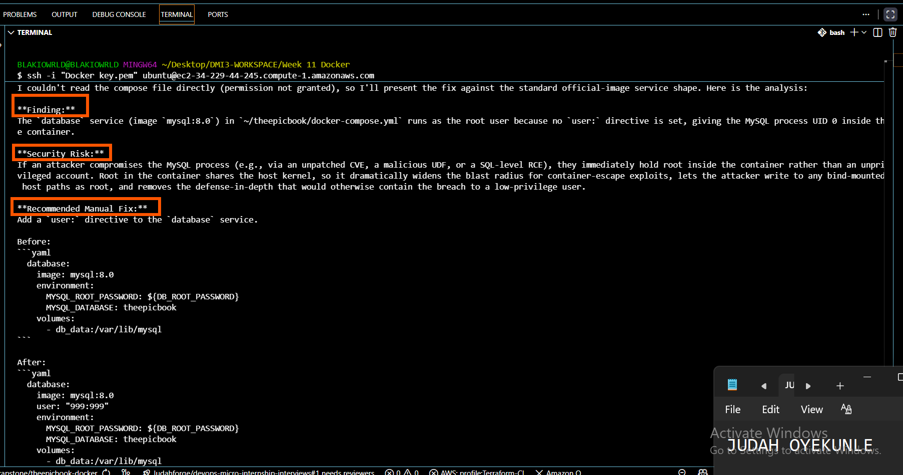
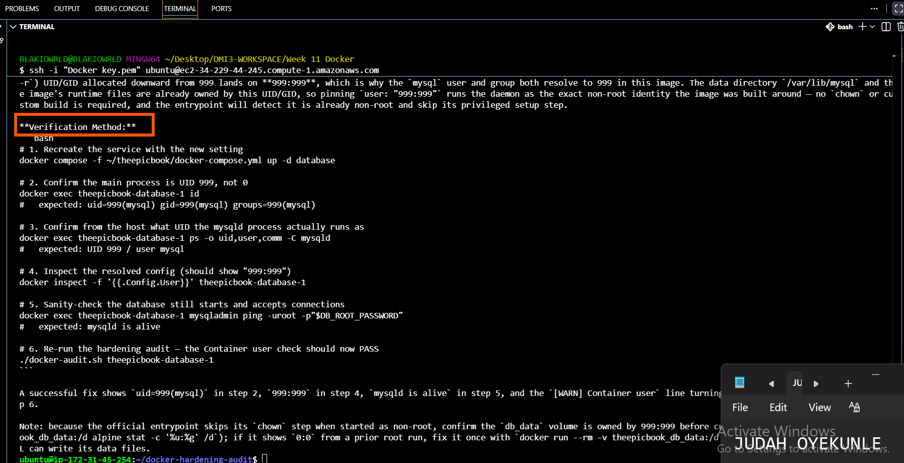

---

# Task 6 — Apply One Container-Hardening Fix

## Goal

Manually fix one WARN or FAIL finding from the initial audit.

### Evidence

#### Screenshot 7 — Hardening Configuration Change

Add a screenshot of the updated Dockerfile or `docker-compose.yml` showing the selected hardening fix.

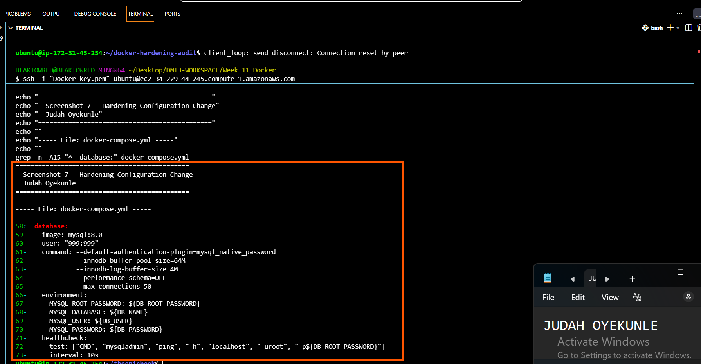

---

#### Screenshot 8 — Updated Service Running

Add a terminal screenshot showing your full name and the rebuilt or recreated service/container running successfully.

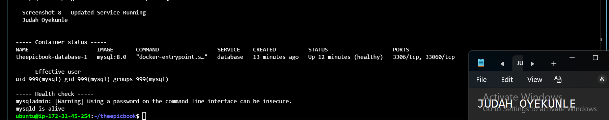

---

# Task 7 — Re-Run the Audit and Compare Results

## Goal

Verify that the selected hardening fix improved the container configuration.

### Evidence

#### Screenshot 9 — Final Audit Results

Add a terminal screenshot showing:

- Your full name
- The updated running container
- The final audit report

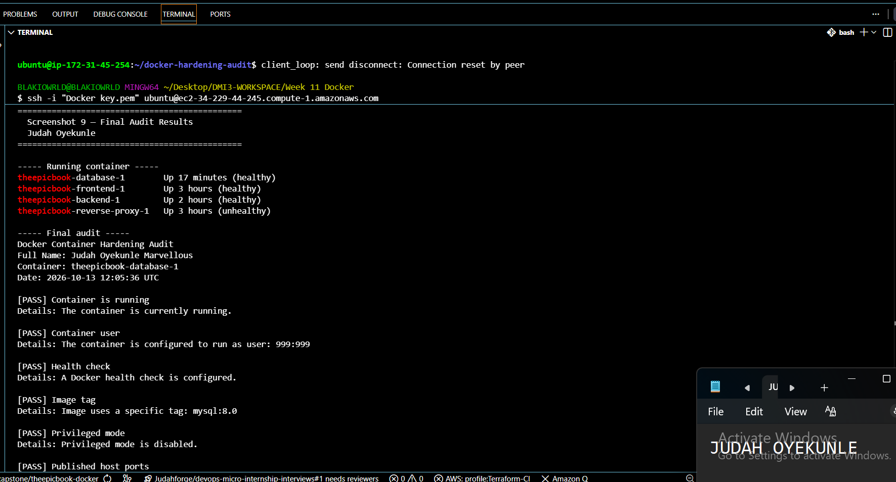
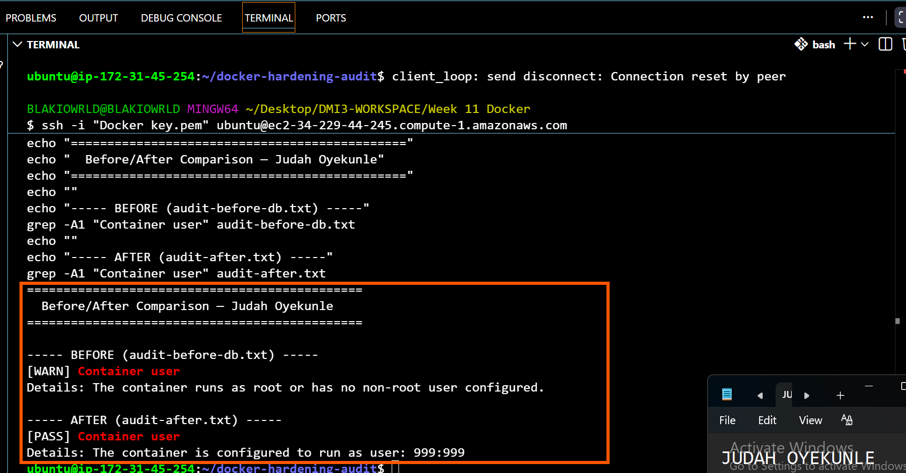

---

### Before-and-After Comparison

Write a short comparison covering:

- Initial audit finding
- Dockerfile or Docker Compose change applied
- Final audit result
- Security benefit of the improvement

# Before-and-After Comparison

## 1. Initial Audit Finding

The initial Docker security audit flagged the database container (`theepicbook-database-1`) for failing the **Container User** check.

```text
[WARN] Container user
Details: The container runs as root or has no non-root user configured.
```

The `database` service in `docker-compose.yml` did not explicitly configure a non-root user, resulting in the MySQL process running as UID 0 (root).

## 2. Docker Compose Change Applied

The `user: "999:999"` directive was added to the `database` service to run the container as the existing `mysql` service account.

**Before:**
```yaml
database:
  image: mysql:8.0
  command: --default-authentication-plugin=mysql_native_password
```

**After:**
```yaml
database:
  image: mysql:8.0
  user: "999:999"
  command: --default-authentication-plugin=mysql_native_password
```

The existing `db_data` volume was already owned by UID/GID `999:999`, so no ownership change was required. The database container was recreated using `docker compose up -d --force-recreate database` and returned to a healthy state within 30 seconds.

## 3. Final Audit Result

After the change, the security audit returned a passing result:

```text
[PASS] Container user
Details: Runs as a non-root user: mysql
```

The container's identity was also verified using `docker exec theepicbook-database-1 id`, which returned:

```text
uid=999(mysql) gid=999(mysql) groups=999(mysql)
```

This confirms that the container runs under the `mysql` service account rather than root.

## 4. Security Benefit

Running MySQL as a non-root user follows the **principle of least privilege** by reducing the privileges available to the database process.

The improvement helps limit the potential impact of a compromise by:

1. **Reducing container escape opportunities:** The process does not automatically have root privileges inside the container.
2. **Limiting access to host-mounted files:** The process has fewer permissions when accessing files outside its own permitted scope.
3. **Restricting unauthorized system changes:** The non-root account has fewer privileges to modify protected files or system components.

This change does not prevent every attack, but it adds an important layer of defense by reducing the privileges available to a compromised database process.

## Conclusion

The initial audit identified that the database container was running as root. After adding `user: "999:999"` to the Docker Compose configuration, the container ran as the non-root `mysql` user, and the subsequent audit passed the Container User check. This demonstrates a measurable security improvement through the application of least privilege.


---

# LinkedIn Requirement

## Goal

Create a LinkedIn post about the container security checks you performed, one hardening improvement you applied, and why the improvement matters.

### Evidence

**LinkedIn Post URL:** `https://lnkd.in/p/dpJAWWAb`

#### LinkedIn Post Screenshot

Add a screenshot of the published LinkedIn post, including the final audit result.

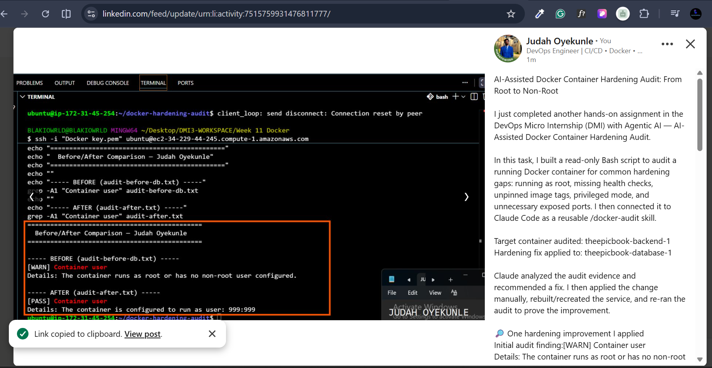

---

# Submission Instructions

- Include Screenshots 1–9 exactly as specified.
- Include the target container name and before-and-after comparison.
- Include the LinkedIn post URL and screenshot.
- Ensure that your full name is visible in all required terminal screenshots.
- Do not expose passwords, API keys, tokens, account IDs, or `.env` file contents.

---

# Completion Checklist

- [ ] Audit workspace created and supplied files verified
- [ ] `docker-audit` skill added to Claude Code
- [ ] Audit script validated successfully
- [ ] Running target container identified
- [ ] Initial Docker audit completed
- [ ] Claude Code explanation of findings captured
- [ ] One hardening fix applied manually
- [ ] Affected service or container rebuilt and recreated
- [ ] Final Docker audit completed
- [ ] Before-and-after comparison completed
- [ ] Screenshots 1–9 included
- [ ] LinkedIn post URL and screenshot included
- [ ] No sensitive information exposed

---

## 📌 About DMI & CloudAdvisory

DevOps Micro Internship (DMI) is a project-based DevOps program run by Pravin Mishra (The CloudAdvisory) focused on real-world execution, systems thinking, and career readiness.

It helps learners build strong DevOps foundations with hands-on experience.

---

## 📌 Resources

- 🌐 DMI Official Website: https://dmi.pravinmishra.com?utm_source=github&utm_medium=readme  
- 🎓 University: https://university.pravinmishra.com?utm_source=github&utm_medium=readme  
- 💬 Discord Community: https://discord.pravinmishra.com?utm_source=github&utm_medium=readme  
- 📝 Blog: https://dmi.pravinmishra.com/blog?utm_source=github&utm_medium=readme  
- ▶️ YouTube Playlist: https://www.youtube.com/playlist?list=PLFeSNDtI4Cho  
- 🔗 Pravin Mishra (LinkedIn): https://www.linkedin.com/in/pravin-mishra-aws-trainer/  
- 🏢 CloudAdvisory (LinkedIn): https://www.linkedin.com/company/thecloudadvisory/

---

*This submission is part of DevOps Micro Internship (DMI) — Agentic AI Track.*
